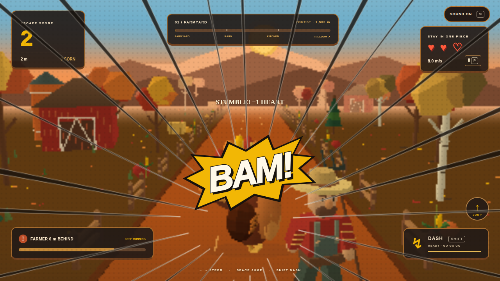

# TEST RESULT — Comic Impact / Gobble Run

Tanggal UTC: 2026-11-27T13:46:26+00:00
Worktree: `/home/hatch/workspace/projects/makefun/work/turkey-game/repo-comic`. Branch: `w-comic`. Baseline: `39ad90c`.

## Implementasi

- `game/src/impact.js`: overlay procedural tanpa gambar, font, dependensi, atau request eksternal baru. Canvas menggambar sekali per hit: 28 speed lines radial beroutline putih dan halftone tinta. Burst kuning mengikuti palet game, dengan teks besar bergilir **BAM! / WHAM! / DOON! / CRASH!**. Tidak ada referensi karya komersial.
- `game/src/main.js`: sinyal callback `name === 'hit'` dari `World.hit()` memicu efek hanya ketika damage diterima; tidak memicu pada mud, pickup, atau hit yang ditolak invulnerability. Hit terakhir sebelum end juga mendapat efek.
- Titik impact menggunakan proyeksi posisi turkey melalui kamera; fallback Canvas 2D memakai pendekatan posisi layar. Zoom hingga 1.09x dan shake sekitar 8px/5px berlangsung 460ms lewat proyeksi kamera 3D; Canvas 2D memakai CSS. Zoom/view kamera dikembalikan setelah efek. Orientasi karakter tidak diubah.
- Hit-stop: skala waktu simulasi 4% selama 85ms, pulih bertahap hingga 100% pada 190ms. Substep berhenti segera ketika hit terdeteksi; render/HUD tetap berjalan. Timer overlay memakai waktu nyata, hilang otomatis pada 640ms. Pause/restart membersihkan efek dan memulihkan kamera.
- `game/src/style.css`: lettering/burst responsif, overlay pointer-events none, dan dukungan reduced motion untuk mematikan shake/zoom. Memakai halftone singkat sebagai aksen hitam-putih; versi akhir tidak memakai flash strobo atau fade layar penuh yang mahal.
- `?shot=` tidak membuat instance/DOM overlay dan tidak menjalankan hit-stop atau mutasi kamera. `shots.js` dan seluruh file terlarang tetap tidak diubah. `hud.js` juga tidak perlu diubah.

## Verifikasi final

Server: `node serve.ts --port 8903`. Chromium headless, viewport 1280×720, DPR 1, flags `--use-gl=angle --use-angle=swiftshader --enable-unsafe-swiftshader`.

- **PASS: 14 pemeriksaan efek/determinisme** di `test-impact.mjs`: tabrakan fence lewat game loop sungguhan menurunkan lives dan menampilkan canvas, lettering, serta zoom kamera; raster tinta terlihat; efek hilang normal 640ms; pause/restart memulihkan; lethal hit tampil; mud/invulnerability tidak memicu; reduced motion menonaktifkan punch.
- **PASS: 28/28 pemeriksaan `test-turkey.mjs`** lewat salinan harness `test-turkey-impact.mjs`. Assertion gameplay asli dipertahankan; hanya lokasi server/port diarahkan ke worktree ini dan output dialihkan ke `/tmp/gobble-impact-regression` agar worker lain tidak terganggu. Hasil: `verification/impact/regression.md`.
- **0 console/page error; 0 external network request** pada rangkaian final. Tidak ada aset jaringan tambahan.
- **PASS: empat pasangan PNG identik byte demi byte**, dan masing-masing cocok dengan main.js baseline `39ad90c` yang disajikan lewat route Playwright. Hasil/hash lengkap tersimpan di `functional-results.json`.

| Pose | SHA-256 PNG | Hasil pair / baseline |
|---|---|---|
| start | `e5a17588489ff0b6e0e41f03677841386e39a666a64b9b0a72d684b72b4a8963` | identik / sama baseline |
| play | `1d531322d63d29a4b628287a825a2ae0ad09d7a52fa6240adf45b9e3a654f96c` | identik / sama baseline |
| chase | `b9fbd4f0534a53837f6f2f7fedca49a95b5bb977b10ffbada7fa7eea83112008` | identik / sama baseline |
| end | `0415c46393964a97cecc79c2c0441901322505af5c4a9a46554f9e35d8fca422` | identik / sama baseline |

## Screenshot benturan



File: `verification/impact/crash.png` (bukti test; bukan screenshot staged yang disubmit). Untuk PNG bukti, pose kamera ditahan pada 140ms dan timeout overlay ditahan. Pemeriksaan hilang otomatis dilakukan pada hit terpisah dengan timer normal; tidak ada penahanan dalam kode game.

## Performa SwiftShader — hasil jujur

GPU: `ANGLE (Google, Vulkan 1.3.0 (SwiftShader Device (Subzero) (0x0000C0DE)), SwiftShader driver)`. Renderer 3D aktif; pixel ratio adaptif berakhir 0.25. Sampling requestAnimationFrame ditargetkan 10 detik setelah warm-up 2 detik; durasi aktual dapat melewati target karena frame lambat. Semua generated entities tetap ada. Pengukuran tanpa damage memakai invulnerability untuk mencegah game berakhir. Stress test menambahkan obstacle di posisi pemain setiap 1.8 detik, mereset invulnerability/lives agar tabrakan bisa diulang; penghitung mencakup warm-up.

| Skenario | FPS | p95 ms | Maks ms | Durasi aktual s |
|---|---:|---:|---:|---:|
| Baseline 39ad90c, tanpa damage | 10.02 | 183.4 | 266.8 | 10.0830 |
| Build akhir, efek tidak aktif | 9.98 | 200.0 | 283.3 | 10.1163 |
| Baseline 39ad90c, forced collision berulang | 9.23 | 200.0 | 216.8 | 10.1829 |
| Build akhir, forced collision + efek aktif | 7.96 | 266.7 | 2783.2 | 11.2995 |

**Keterbatasan:** performa steady saat efek tidak aktif masih sekitar baseline (~10 FPS). Efek aktif masih menambah biaya pada SwiftShader: stress test akhir 7.96 FPS / p95 266.7ms, dibanding baseline forced collision 9.23 FPS / p95 200.0ms. Tercatat satu frame maksimum 2783.2ms. Jadi persyaratan tanpa penurunan performa selama efek aktif belum sepenuhnya tercapai; ini bukan klaim bahwa seluruh anggaran performa lulus. Angka referensi brief sebelumnya ~9.95 FPS / p95 ~199.9ms.

Optimasi yang dilakukan: mengganti 28 elemen ray/mask/fade yang dianimasikan dengan satu canvas setengah resolusi yang digambar sekali per hit; pola dot memakai tile; shake/zoom WebGL lewat kamera; lettering dan halftone statis selama beat singkat. Prototipe komposit animasi sebelumnya menunjukkan biaya lebih besar dan tidak dipertahankan. Satu sesi Chromium awal tertutup saat memasuki pengukuran panjang; tes fungsional akhir dan seluruh pengukuran yang dilaporkan di atas selesai dengan exit 0 dalam proses terpisah.

## Reproduksi

Dengan server port 8903 sudah berjalan:

```sh
node test-impact.mjs
node test-impact.mjs --perf-only --baseline
node test-impact.mjs --perf-only
node test-impact.mjs --perf-only --baseline --active
node test-impact.mjs --perf-only --active
node test-turkey-impact.mjs
```

Jalankan pengukuran secara berurutan dalam browser baru agar tidak saling membebani. Data mentah: `functional-results.json`, `results.json`, `perf-baseline.json`, `perf-baseline-active.json`, `perf-active.json`.

Tidak ada push, submit, bundle, atau make.fun check. Perubahan kode game hanya pada `main.js`, `style.css`, dan file baru `impact.js`.
